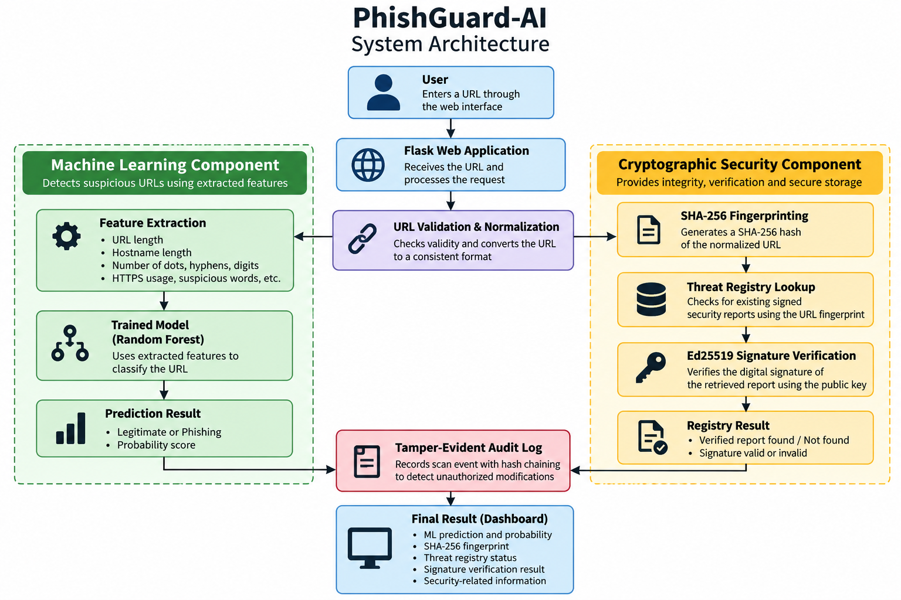
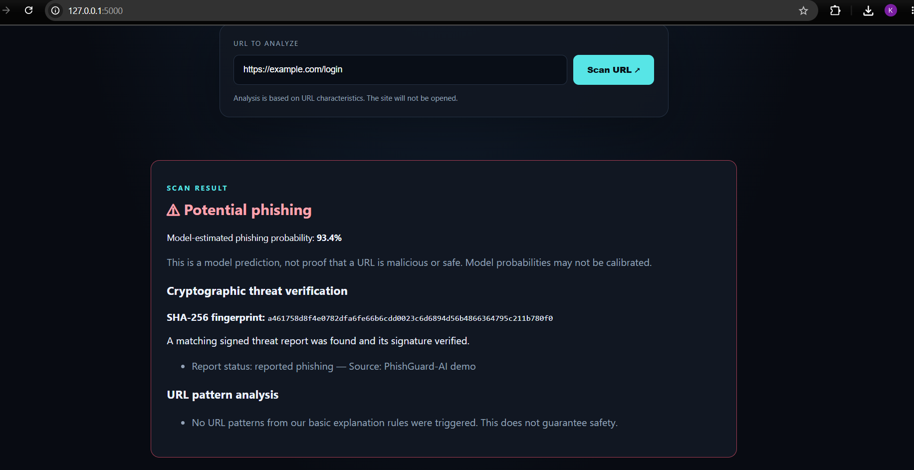

# PhishGuard-AI


## Secure Phishing URL Detection Using Machine Learning and Cryptography


PhishGuard-AI is a web-based security system designed to detect suspicious phishing URLs using machine learning and provide additional security verification using cryptographic techniques.


The system analyzes the characteristics of a URL using a machine learning model and generates a phishing prediction. It also creates a SHA-256 fingerprint for the normalized URL and uses digitally signed threat reports to verify the integrity of stored security information.


A tamper-evident audit log records important scan events so that unauthorized changes to previous records can be detected.


\---


## 1. Project Overview


Phishing attacks often use fake or misleading URLs to trick users into visiting malicious websites or providing sensitive information.


PhishGuard-AI provides a simple web interface where a user can enter a URL and receive a security analysis.


The project combines:


\- Machine learning for phishing URL detection

\- SHA-256 hashing for URL fingerprinting

\- Ed25519 digital signatures for report verification

\- A signed threat registry

\- Hash-chained audit logging

\- Flask for the web application


The system is intended as an educational cybersecurity project demonstrating how machine learning and cryptographic security techniques can work together.


\---


## 2. Objectives


The main objectives of PhishGuard-AI are:


1\. Detect suspicious URLs using machine learning.

2\. Extract meaningful security-related characteristics from URLs.

3\. Generate a SHA-256 fingerprint for each normalized URL.

4\. Maintain a registry of signed threat reports.

5\. Verify the integrity of threat reports using Ed25519 digital signatures.

6\. Maintain a tamper-evident audit trail of scan events.

7\. Provide all results through a simple Flask web interface.


\---


## 3. Key Features


### Machine Learning-Based Detection


The system analyzes URL characteristics such as:


\- URL length

\- Hostname length

\- Path length

\- Number of dots

\- Number of hyphens

\- Number of digits

\- Number of slashes

\- Suspicious words

\- Number of subdomains

\- HTTPS usage

\- IP address usage


A Random Forest model uses these features to estimate whether the URL appears suspicious.


### SHA-256 URL Fingerprinting


Each normalized URL is converted into a SHA-256 hexadecimal fingerprint.


The fingerprint provides a fixed-length cryptographic representation of the URL.


A small change in the URL produces a different fingerprint.


### Digital Signature Verification


Threat reports stored by the system can be digitally signed using Ed25519.


The corresponding public key is used to verify whether a stored report has been modified after signing.


### Signed Threat Registry


The project maintains a local registry containing security reports associated with URL fingerprints.


Each report contains information such as:


\- URL fingerprint

\- Report status

\- Source

\- Digital signature


Only reports with valid signatures are treated as verified reports.


### Tamper-Evident Audit Log


Important scan events are stored in a hash-chained audit log.


Each entry is linked to the hash of the previous entry. If an earlier entry is modified, the chain can be detected as inconsistent.


\---


## 4. System Architecture



The overall workflow is:


```text

&#x20;                   USER

&#x20;                     |

&#x20;                     v

&#x20;             +---------------+

&#x20;             |  Flask Web UI  |

&#x20;             +-------+-------+

&#x20;                     |

&#x20;                     v

&#x20;             +---------------+

&#x20;             | URL Validation |

&#x20;             +-------+-------+

&#x20;                     |

&#x20;                     v

&#x20;             +---------------+

&#x20;             | URL Normalize  |

&#x20;             +-------+-------+

&#x20;                     |

&#x20;            +--------+--------+

&#x20;            |                 |

&#x20;            v                 v

&#x20;     +-------------+    +-------------+

&#x20;     | ML Analysis |    |  SHA-256    |

&#x20;     |             |    | Fingerprint |

&#x20;     +------+------+    +------+------+

&#x20;            |                  |

&#x20;            v                  v

&#x20;     +-------------+    +-------------+

&#x20;     | Prediction  |    |   Threat    |

&#x20;     |             |    |  Registry   |

&#x20;     +------+------+    +------+------+

&#x20;            |                  |

&#x20;            |                  v

&#x20;            |           +-------------+

&#x20;            |           | Ed25519     |

&#x20;            |           | Verification|

&#x20;            |           +------+------+

&#x20;            |                  |

&#x20;            +--------+---------+

&#x20;                     |

&#x20;                     v

&#x20;             +---------------+

&#x20;             |  Audit Log    |

&#x20;             +-------+-------+

&#x20;                     |

&#x20;                     v

&#x20;             +---------------+

&#x20;             | Final Results  |

&#x20;             |   Dashboard    |

&#x20;             +---------------+

## 18. Screenshots

### Main URL Scan



The dashboard displays the machine learning prediction, probability, SHA-256 fingerprint, and threat registry status.

### Cryptographic Verification


A matching signed threat report is found and its Ed25519 digital signature is successfully verified.

### Tamper Detection

The project also includes a controlled tampering test:

```text
Original records: 1
Records verified after tampering: 0
Tampering detected: True